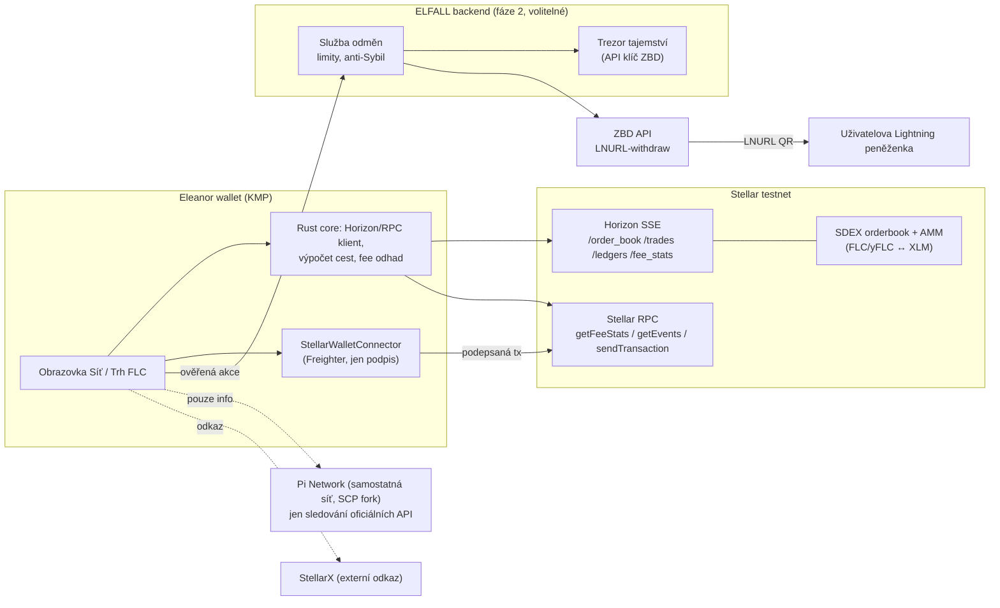

# Návrh: StellarX, Pi Network a sats výdělky pro ELFALL (varianty A/B/C)

> **Stav:** NÁVRH k diskusi. Žádný kód se nemění. Nic se neimplementuje bez schválení Ivo Faltýna.
> **Datum rešerše:** 14. 10. 2026
> **Rozsah:** Eleanor wallet + token Fallcoin (FLC/yFLC) na Stellar **testnetu**.
> **Bezpečnost:** dokument neobsahuje a nikdy nesmí obsahovat privátní klíče ani seed fráze. Vše je čistě obranné (defense-only); podpisy probíhají výhradně ve Freighteru (viz `shared/src/commonMain/kotlin/cz/faltyn/elfall/shared/stellar/StellarWalletConnector.kt` a `StellarOwnerWallet.kt` v PR #27).

## 1. Shrnutí

- **StellarX** je webové rozhraní (frontend) nad vestavěnou decentralizovanou burzou Stellaru (SDEX) a AMM pooly. Web stellarx.com k 14. 10. 2026 odpovídá (HTTP 200), ale britská společnost **STELLARX LTD byla 30. 12. 2025 zrušena dobrovolným výmazem** z rejstříku. Veřejné, dokumentované API StellarX neexistuje. Data, která StellarX zobrazuje, ale pocházejí přímo ze sítě Stellar, takže je ELFALL může číst sám přes **Horizon / Stellar RPC**. Na StellarX samotném závislí nebudeme.
- **„Napojení na mempool“:** Stellar nemá mempool v bitcoinovém smyslu. Ledger se uzavírá zhruba každých 5 s konsensem SCP. Odpovídá mu (a) fronta transakcí čekajících na zařazení do ledgeru se **surge pricingem** (podle výše inclusion fee), (b) **streamování** ledgerů, transakcí, obchodů a orderbooku přes Horizon (SSE) a (c) **orderbook SDEX**.
- **Pi Network:** Open Network běží od 20. 2. 2025 a existuje **Pi SDK** (JavaScript, funguje v Pi Browseru) pro přihlášení a platby. „Těžba“ Pi ale **není skutečná těžba**: je to denní klepnutí v mobilní aplikaci. **Aplikace třetích stran Pi těžit nemohou.** Pi je postavené na forku Stellar Consensus Protocolu, jde ovšem o **samostatnou síť**. Oficiální most Pi ↔ Stellar neexistuje.
- **Sats výdělky:** legitimní cestou jsou Lightning výplaty, např. LNURL-withdraw přes ZBD API, vyplácené z rozpočtu projektu za skutečnou aktivitu. Částky jsou malé a závisí na tom, jestli někdo platí. Nejde o „pasivní příjem“.
- **Doporučení:** **varianta C v osekané podobě**. Začít read-only SDEX/fee „mempool“ dashboardem pro FLC na testnetu (jádro varianty A). Sats odměny ponechat jako volitelný pilot za schválením a Pi omezit na sledování oficiálních API, bez mostu.

## 2. Co je realisticky možné vs. nemožné

| Přání | Možné ✅ | Nemožné / nedoporučené ❌ |
|---|---|---|
| StellarX „do mempoolu“ | Streamovat orderbook SDEX, obchody, ledgery a fee statistiky přes Horizon/RPC. Ukázat cesty FLC↔XLM (`/paths/strict-send`, `/paths/strict-receive`). | Volat „StellarX API“: není veřejné ani dokumentované, a provozovatel byl zrušen. Bitcoinový mempool na Stellaru neexistuje. |
| Transakční fronta | Číst `fee_stats` / `getFeeStats`, doporučit poplatek, sledovat stav odeslané transakce, použít fee-bump. | Vidět „čekající transakce cizích lidí“ ve stylu mempool.space. Stellar je veřejně nevystavuje. |
| Pi Network jako zdroj těžby | Sledovat oficiální Pi SDK/API. Případně samostatná Pi Browser mini-aplikace s Pi platbami (vyžaduje schválení Pi Core Teamem). | Těžit Pi z ELFALL. Pi „mining“ je klepnutí v oficiální mobilní aplikaci a třetí strany ho provozovat nemohou. Vlastní most Pi↔Stellar bez oficiální podpory. |
| Sats jako vedlejší příjem | Lightning odměny (LNURL-withdraw) z předfinancovaného rozpočtu za ověřenou aktivitu, např. dokončení testnet úkolu. | Hazard, „klikni a vydělej“ farmy, slibování výnosu, těžba BTC na mobilu (nerentabilní, vybíjí baterii). |
| Kombinace do vlastního konceptu | ELFALL jako „Stellar hub“: přehled SDEX + FLC cesty + volitelné sats odměny. | Slučovat sítě Pi, Stellar a BTC do jednoho „wrapped“ tokenu bez licence a auditu. |

## 3. Varianty

### Varianta A: „Stellar mempool“ (SDEX + fee monitor), pouze čtení

- **Co:** Rust core / KMP modul, který streamuje přes Horizon SSE `/order_book`, `/trades`, `/ledgers`, čte `/fee_stats` a vypočítá cesty FLC↔XLM. Eleanor wallet z toho zobrazí obrazovku „Síť“: hloubku trhu FLC, poslední obchody, aktuální poplatek a odhad zařazení.
- **Proč:** tohle je to, co „mempool“ na Stellaru skutečně znamená. Nulové riziko pro prostředky (read-only) a navazuje na existující Freighter wiring.
- **Kdy použít:** hned jako první krok, na testnetu. **Kdy ne:** pokud by měl vzniknout vlastní obchodní engine. To je mimo rozsah.
- **Náročnost:** cca 1–2 týdny (klient Horizon/RPC, SSE reconnect, UI, testy).
- **Rizika:** *bezpečnost:* minimální, bez podpisů. Ověřovat network passphrase (testnet vs. mainnet) a ošetřit podvržené assety se stejným kódem „FLC“ (kontrolovat issuer). *Regulace:* čisté zobrazení dat není služba CASP podle MiCA. Zobrazení cen nesmí působit jako investiční doporučení. *Podvody:* falešné tokeny a phishingové domény, proto whitelist issuera. *Technicky:* Horizon je označen za zastaralý ve prospěch Stellar RPC. Návrh proto počítá s abstrakcí, aby šlo přejít na RPC (`getFeeStats`, `getEvents`, `getTransactions`).

### Varianta B: Sats odměny přes Lightning (+ Pi jen jako sledování)

- **Co:** backend (nikdy ne klient) vytvoří přes ZBD API jednorázový LNURL-withdraw (např. 50–500 sats, expirace 5 min) za ověřenou akci, např. dokončený testnet tutoriál. Uživatel si sats vybere do vlastní Lightning peněženky. K Pi: pouze stránka se stavem a odkazy na oficiální Pi, žádná integrace těžby.
- **Proč:** jediná legitimní forma „sats výdělku“ v aplikaci. Je transparentní a rozpočet je omezený.
- **Kdy použít:** až bude existovat uživatelská základna a rozpočet na odměny. **Kdy ne:** pokud by odměny měly být hlavním lákadlem nebo „příjmem“, nebo pokud nelze zajistit anti-Sybil ochranu.
- **Náročnost:** cca 2–3 týdny (backend, API klíč v trezoru, limity, anti-abuse, právní text).
- **Rizika:** *bezpečnost:* API klíč ZBD = přístup k penězům. Musí být jen na serveru, mít denní strop a samostatnou peněženku s malým zůstatkem. *Regulace:* vyplácení BTC uživatelům může spadat pod AML (v EU od 2024 platí „travel rule“ podle nařízení 2023/1113 pro převody kryptoaktiv). Nutná je konzultace s právníkem, jestli jde o propagační odměnu, nebo o službu. ZBD sám vyžaduje KYC projektu a má geografická omezení. *Podvody:* boti a farmy účtů, proto rate-limit, ověření a malé částky. Nikdy neslibovat výnos.

### Varianta C: Vlastní koncept Ivo, „ELFALL Hub“ (kombinace)

- **Co:** ELFALL jako Stellar-centrický hub:
  1. **Jádro = varianta A** (SDEX/fee „mempool“ pro FLC/yFLC, cesty FLC↔XLM, podpis jen ve Freighteru).
  2. **Výuka a odměny:** úkoly na testnetu (vytvořit trustline k FLC, provést path payment) odměněné malým množstvím sats přes Lightning (varianta B) nebo testnet FLC.
  3. **Pi most pouze pokud bude oficiálně podporován.** Dnes není, takže jde jen o sledování. Případně samostatná Pi Browser mini-aplikace (např. přijímání Pi plateb za službu), ne součást Eleanor wallet.
- **Proč:** splňuje Ivovo přání kombinace a přitom stojí na tom, co reálně existuje. Pi i Stellar používají SCP, takže se znalosti přenášejí, ale sítě se nepropojují.
- **Kdy použít:** jako cílová vize, postupně po fázích. **Kdy ne:** pokud by měl vzniknout vlastní most mezi sítěmi nebo custodial držení prostředků uživatelů. To by vyžadovalo licenci CASP podle MiCA (dozor ČNB) a audit.
- **Náročnost:** fáze 1 (A) 1–2 týdny, fáze 2 (odměny) 2–3 týdny, fáze 3 (Pi) nejasná a závislá na Pi Core Teamu.
- **Rizika:** součet rizik A + B. Navíc *reputační riziko*: Pi Network je často zneužíváno podvodníky (falešné „Pi wallet“ aplikace kradoucí passphrase). ELFALL proto nikdy nesmí žádat Pi passphrase ani jiný seed. *Regulace:* FLC na mainnetu by mohl být kryptoaktivem podle MiCA hlavy II (white paper, oznámení). Na testnetu ne. Viz `docs/mica-checklist.md`.

## 4. Doporučení

**Varianta C, ale postupně a začít jen fází 1 (= varianta A).** Důvody: read-only, bez rizika pro prostředky, bez regulatorní zátěže, a přímo odpovídá na „napojení na mempool“ tak, jak to na Stellaru dává smysl. Sats odměny (fáze 2) až po právní konzultaci a se stropem rozpočtu. Pi Network jen sledovat. Žádný most a žádná „těžba Pi“, protože to technicky ani pravidly Pi nejde. StellarX používat nanejvýš jako externí odkaz pro uživatele, ne jako závislost (zaniklý provozovatel, žádné API).

## 5. Architektura (mermaid)

## 6. Další kroky (vše pouze po schválení Ivo)

1. Ivo potvrdí variantu (doporučeno C, fáze 1).
2. Technický návrh modulu „SDEX monitor“: rozhraní, které zvládne Horizon i RPC, a whitelist issuera FLC/yFLC na testnetu.
3. Prototyp na testnetu, read-only, s testy reconnectu SSE a kontrolou network passphrase.
4. Fáze 2 jen po: právní konzultaci (AML/MiCA, ČNB), schváleném rozpočtu a stropu odměn a bezpečnostní revizi (`docs/security-review.md`).
5. Pi: jednou za čtvrtletí zkontrolovat oficiální dokumentaci. Integrace jen při oficiální podpoře a jako oddělená Pi Browser aplikace.
6. Žádné privátní klíče ani seed fráze v repozitáři, logech ani backendu. Podepisuje výhradně Freighter.

## Zdroje

- StellarX web (k 14. 10. 2026 odpovídá): https://www.stellarx.com/
- Companies House, STELLARX LTD, zrušena 30. 12. 2025: https://find-and-update.company-information.service.gov.uk/company/12975821/filing-history
- Stellar APIs, Horizon označen za zastaralý ve prospěch RPC: https://developers.stellar.org/docs/data/apis
- Migrace Horizon → RPC: https://developers.stellar.org/docs/data/apis/migrate-from-horizon-to-rpc
- Poplatky, surge pricing, fee-bump: https://developers.stellar.org/docs/learn/fundamentals/fees-resource-limits-metering
- RPC `getFeeStats`: https://developers.stellar.org/docs/data/apis/rpc/api-reference/methods/getFeeStats
- Pi Open Network (spuštěno 20. 2. 2025): https://minepi.com/blog/open-network-anniversary/
- Pi Day 2026 (protocol 20, App Studio mainnet): https://minepi.com/blog/pi-day-2026/
- Pi SDK Quick Start: https://pi-apps.github.io/community-developer-guide/docs/gettingStarted/quickStart/
- Spuštění na Pi Mainnet (schvalování peněženek Pi Core Teamem): https://pi-apps.github.io/pi-sdk-docs/Launch
- Pi whitepaper (konsensus odvozený ze SCP, mobilní „mining“): https://minepi.com/white-paper
- ZBD Withdrawal Requests (LNURL-withdraw): https://docs.zbdpay.com/payments/payouts/withdrawal-requests
- MiCA, nařízení (EU) 2023/1114: https://eur-lex.europa.eu/eli/reg/2023/1114/oj
- Nařízení (EU) 2023/1113 (travel rule): https://eur-lex.europa.eu/eli/reg/2023/1113/oj
